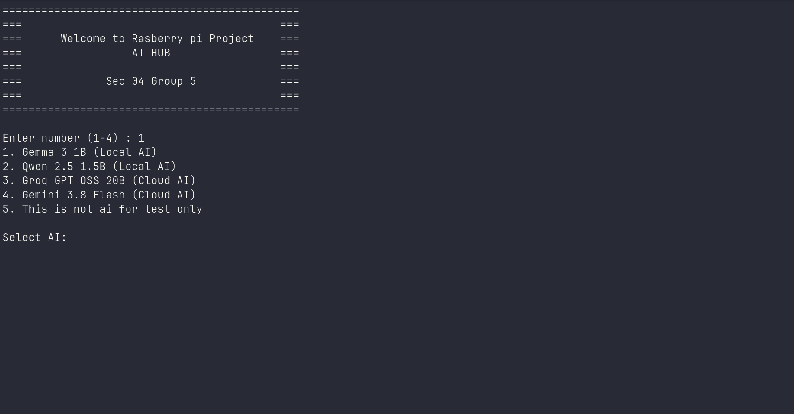
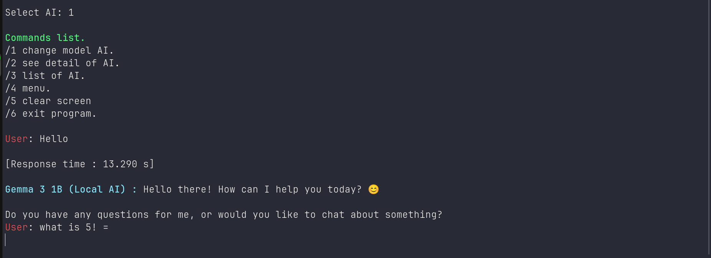
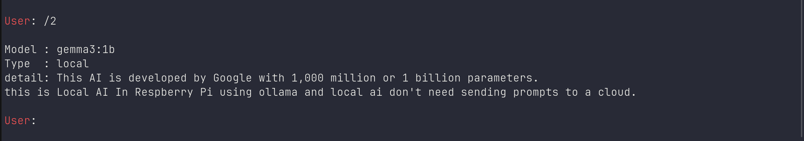

# Raspberry Pi Multi-AI Hub

A terminal-based AI hub built with Python on Raspberry Pi. The project explores how local AI models and cloud AI APIs can be accessed through a single command-line interface.

## Overview

Raspberry Pi Multi-AI Hub is a personal project focused on running and managing AI interactions on a resource-constrained Linux device.

The goal is to provide a unified terminal interface for selecting AI services and sending prompts, while exploring the trade-offs between local inference and cloud-based AI.

## Features

- **Terminal UI:** Interact with AI services through a command-line menu.
- **AI Registry:** Store AI service configuration in `aiRegistry.json`.
- **Local AI:** Connect to locally hosted models through Ollama.
- **Cloud AI:** Integrate with cloud AI APIs using environment-based credentials.
- **Linux Environment:** Develop and run the application on Raspberry Pi OS/Linux.
- **Configuration Management:** Separate model configuration from secret API credentials.

*Only list features that have been tested and work in the current version.*

## Technology Stack

- Python
- Linux / Raspberry Pi
- Ollama
- JSON
- Git and GitHub
- Cloud AI API integration

## Architecture

```text
User
 |
 v
Terminal UI (main.py)
 |
 v
AI Registry (aiRegistry.json)
 |
 v
AI Provider
 |              |
 v              v
Ollama       Cloud API
(Local)      (Internet)
```

## Project Structure

```text
labOS/
├── main.py
├── aiRegistry.json
├── .gitignore
└── README.md
```

The project structure may evolve as provider logic and configuration are organized into separate modules.

## Hardware

- Raspberry Pi 5
- 4 GB RAM
- microSD storage

## Security

- API credentials are stored in a local `.env` file.
- Secret files and the Python virtual environment are excluded through `.gitignore`.
- Never commit API keys, access tokens, or other credentials.

## How to Run

1. Clone the repository.
2. Install Python and the required dependencies.
3. Create a local `.env` file with the environment variables required by your selected cloud provider.
4. Ensure Ollama is running if you want to use local models.
5. Run the application using Python.

Exact installation commands and required environment variables will be documented after the dependencies and configuration are verified.

## What I Learned

- Working with Linux on Raspberry Pi.
- Using SSH for remote development and administration.
- Managing Python dependencies with virtual environments.
- Integrating local AI inference and cloud AI APIs.
- Designing a terminal-based application and a JSON-based AI registry.
- Using Git and GitHub to version and publish a software project.

## Current Status

Personal learning project under active development. Provider availability, API quotas, hardware constraints, and error handling are areas for continued testing and improvement.

## Future Improvements

- Improve provider error handling and connection status reporting.
- Add clearer setup instructions and usage examples.
- Organize provider integrations into separate modules.
- Add automated tests and screenshots of working features.

## Demo

Start manu

Chat with Gemma local ai

detail of Gemma



